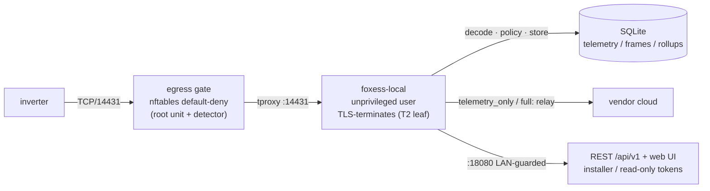

# foxess-local

I wrote this app for people who want to take back control of their FoxESS inverters. Maybe you want a reliable API and web UI that runs locally.
Maybe you don't trust VPP operators or your installer. Maybe you're worried about the (insecure) connection to Foxess being intercepted and abused.


## Headline features

- isolate your inverter from the cloud either fully or partially with a single change to the inverter.
- expose your inverter on the local network via a web interface, HTTP API, prometheus endpoint and MCP
- manage access via bearer tokens, each associated with a role, all controllable by you. Anonymous readonly access is optional.
- view current and historical data
- manage mode scheduler, current/power limits, meter compensation and more.
- validated on a KH10 inverter, leveraging HA's foxess-modbus integration to provide a starting point for other inverter models. Care has been taken to not write to other models until safe.
- push notifications (ntfy, webhooks) when critical events occur, including a lost grid, a restart after a power cut and a low or falling battery (with a configurable forecast)
- a web UI in English, German, French, Italian, Spanish and Simplified Chinese (the non-English translations are machine-made; corrections welcome)
- gentle on SD cards and eMMC: readings can be held in memory and written in batches (configurable)
- access to review and record the data frames being sent back and forth, either for personal use or to provide diagnostics to the developers for incorporation into future releases
- fully open source (GPL). Make your own copy, audit it, have complete confidence it does what it says.


## Summary

Local monitoring and control for FoxESS hybrid inverters, without the
FoxESS cloud. One Go binary on a small Linux machine that is the
inverter's network gateway: it terminates the inverter's proprietary cloud
connection (framed binary over TCP/14431), decodes every frame, keeps the
data locally, and serves a REST API and web UI — live power, battery,
history, work mode, limits and schedule. The cloud stays optional: cut it
off, give it read-only data, or keep it fully connected.

**Status: beta.** Verified on the KH series (KH10, firmware 1.73 / 1.03 /
1.71). Other FoxESS models are supported read-only and tentatively, using
the community [foxess_modbus](https://github.com/nathanmarlor/foxess_modbus)
register maps; their settings stay locked until verified.

- **Install:** [INSTALL.md](INSTALL.md) — an installer for a Raspberry Pi or
  any small Linux box with systemd; signed releases; updates from the web
  UI without root.
- **Home Assistant:** through the REST API and its event stream (the
  foxess-control integration's local backend); the API is described in
  [`api/openapi.yaml`](api/openapi.yaml).
- **Releasing:** [RELEASING.md](RELEASING.md).

## How it works



- **Gate** (C-007): default-deny on the inverter's source IP. Only the
  tproxied cloud channel, DNS (local resolver, observation only), and NTP
  pass; everything else drops + logs.
- **Frame service**: sole decoder. c2s is recorded; every s2c frame passes
  one policy decision (C-001: upstream→inverter is deny-all except `full`
  mode, an active maintenance window, and read requests in
  `telemetry_only` — C-002, D-024). Each answer from the inverter goes to
  whoever asked: the cloud's to the cloud, the app's own never to the
  cloud. The bootstrap-response trio is generated locally
  (the inverter trusts any CA — T2 anchor, leaf signed by the eMudhra G3C
  intermediate).
- **Gateway** (C-003): the only operator write path — validated,
  range-clamping, read-modify-write. The frame service is the only
  upstream→inverter path.
- **Maintenance window**: a time-boxed override (installer-gated,
  `POST/DELETE /api/v1/maintenance`) during which the channel is an
  unfettered bidirectional pass-through — the cloud may do anything
  upstream, firmware pushes included (the only way a firmware push
  reaches the inverter).

### Forward modes

| mode | s2c to inverter | c2s to cloud | use |
|---|---|---|---|
| `full` | every kind of frame the cloud is known to send (settings, schedules, reads); anything else — a firmware push — is held until a maintenance window | everything | an explicit installer-gated audited opt-in |
| `telemetry_only` | the cloud's read requests only (no write ever) | everything, except answers to the app's own reads | the FoxESS app keeps working read-only + local control |
| `off` | none (no cloud leg at all — hook-generated frames only) | none | the default since 2026-11-17 — fully local; the vendor cloud receives nothing |

The **maintenance window** overrides the configured mode while it is
active (30 min default; a `POST` re-arms, `DELETE` closes; per-call cap
4 h). It is process-local — it does not survive a restart. The mode is
the persistent setting; it is back in force on expiry or close.

A window can be opened with **capture** ("Record the traffic"): every
byte of the window's traffic, both directions, is kept as received —
before any parsing or policy — in prox's capture layout under
`captures/` next to the database, so a firmware update is recorded in
full. Captures are listed under Cloud & maintenance, downloaded as
`.tar.gz` (not de-identified: they hold the serials) and kept until
deleted; one window stops recording at `retention.capture_max_mb`
(default 256).

## Security model

| Surface | Runs as | Privilege |
|---|---|---|
| Egress gate (nftables + TPROXY) | root units, fixed checked-in scripts | blocks everything the inverter sends except its cloud channel (handed to the app), DNS and NTP; fails closed from early boot |
| Gate check (every 5 min) | root | re-applies the gate if rules vanish; alerts in the journal |
| The app | unprivileged `foxess` user | `CAP_NET_ADMIN` only (the TPROXY listener), systemd-sandboxed, writes only its state directory |
| Web UI and API (:18080) | the app | LAN sources only; every write needs a token with the right role (read-only < standard < expert < installer) |

Every write to the inverter passes one gateway that validates and clamps
the value, reads the current value first and skips unchanged writes,
rations real writes (the inverter's settings memory has limited
endurance), and confirms the result. Writes are only allowed on a
verified model and firmware, or under an installer's audited, per-device
grant.

## Development

```bash
go build ./...
go test ./...
prek run --all-files     # the lint hooks CI runs (golangci-lint, shellcheck)
make all                 # the stamped binary + the standalone installer.sh
go run ./tools/devui     # the real API + UI over a seeded demo store (no inverter)
```

Go 1.27, pure Go (no cgo), one binary. Tests are written first; anything
time-driven runs on `testing/synctest` virtual time.

Documentation:

- [`docs/recon/protocol-profile.md`](docs/recon/protocol-profile.md) — the
  inverter's cloud protocol as decoded: framing, handshake, telemetry and
  snapshot classes, the command and register map (§5), open items (§8).
- [`docs/knowledge/`](docs/knowledge/) — vision, constraints, architecture,
  design decisions, test inventory and known deficiencies.
- [`tools/mon150`](tools/mon150) — the frame decoder used for protocol
  work on captures; [`tools/probe-registers.sh`](tools/probe-registers.sh)
  reads register blocks through the API.

## Configuration reference

All optional. Paths derive from `state_dir` unless set explicitly.

| key | default | meaning |
|---|---|---|
| `state_dir` | `/var/lib/foxess-local` | root of the store, tokens and certs (absolute) |
| `forward.mode` | `off` | `off` \| `telemetry_only` \| `full` — what the vendor cloud may receive (C-001/C-002); also settable in the web UI, which wins over the file |
| `forward.upstream_cas` | embedded vendor cloud root | PEM files trusted on the upstream (real cloud) leg |
| `server.inverter_listen` | `0.0.0.0:14431` | TPROXY listener; port must equal the gate's tproxy target |
| `server.http_listen` | `0.0.0.0:18080` | REST/UI listener |
| `access.public_read_only` | `true` | unauthenticated GET floor (the dashboard) |
| `access.public_all_pages` | `false` | unauthenticated sessions may also open the other pages (read-only); off: dashboard only, no page tabs |
| `net.allow_public` | `false` | LAN-source guard |
| `net.extra_allowed` | `[]` | extra allowed source CIDRs |
| `net.host_names` | `[]` | extra names the UI may be reached by (others are refused: DNS rebinding); IPs, localhost, the hostname and `.local`/`.lan`/`.home.arpa`/`.internal` always work |
| `retention.raw_hours` | `72` | raw frame/telemetry retention (measured from stream close) |
| `retention.buckets_days` | `365` | rollup horizon |
| `retention.min_free_mb` | `200` | disk guard: below this much free space (capped at 10 % of the filesystem) the oldest raw data is discarded hourly, and upgrades do not download |
| `retention.chunk_bytes_hours` | `0` | captured payload bytes kept after close (trace contribution); 0 = off |
| `store.path` | `<state_dir>/foxess.db` | SQLite path |
| `tokens.path` | `<state_dir>/tokens.json` | token store |
| `certs.manifest` | `<state_dir>/certs/cert-manifest.json` | cert material; missing on first start → the app self-bootstraps the T2 anchor there |
| `battery.capacity_wh` | unset | usable pack energy across SoC 0–100 % (Wh); stored energy = SoC × capacity; unset = unknown (the setup wizard asks; a UI value wins over the file) |
| `[[scheduler.windows]]` | `[]` | force-charge windows |
| `sim.*` | off | cloud-API stand-in (dev) |

Retired 2026-11-16 (load with a warning, do nothing): `server.lan_listen`
(the plan-1 LAN broker, removed 2026-11-18), `[identity]` (prox mints
the inverter-facing leaf per connection), `broker.data_dir` and
`broker.capture` (never read). Renamed 2026-11-18: `broker.cert_manifest`
→ `certs.manifest` (the old key still works, with a warning). The installer no longer ships
`/etc/foxess-local/cloud-root.pem` — the root is embedded; an existing
`upstream_cas` pointing at that file still works as an override.

## Licence

foxess-local is free software: you can redistribute it and/or modify it
under the terms of the GNU General Public License as published by the Free
Software Foundation, either version 3 of the License, or (at your option)
any later version. See [LICENSE](LICENSE); third-party material and its
licences are listed in [THIRD_PARTY.md](THIRD_PARTY.md).

It is distributed in the hope that it will be useful, but WITHOUT ANY
WARRANTY; without even the implied warranty of MERCHANTABILITY or FITNESS
FOR A PARTICULAR PURPOSE. It talks to a power system: use it at your own
risk, and keep the inverter's own controls within reach.
